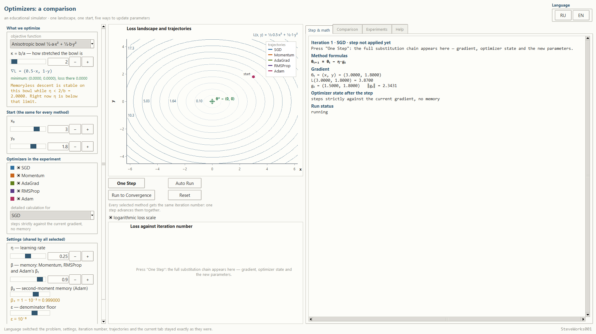
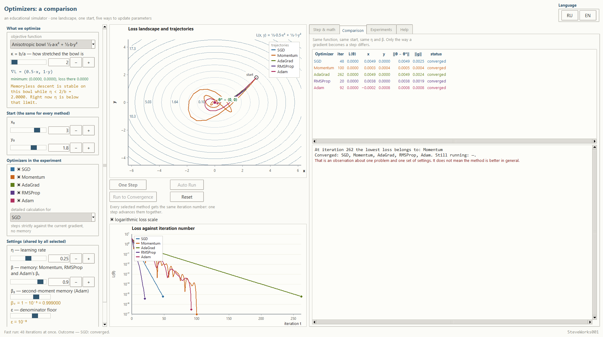
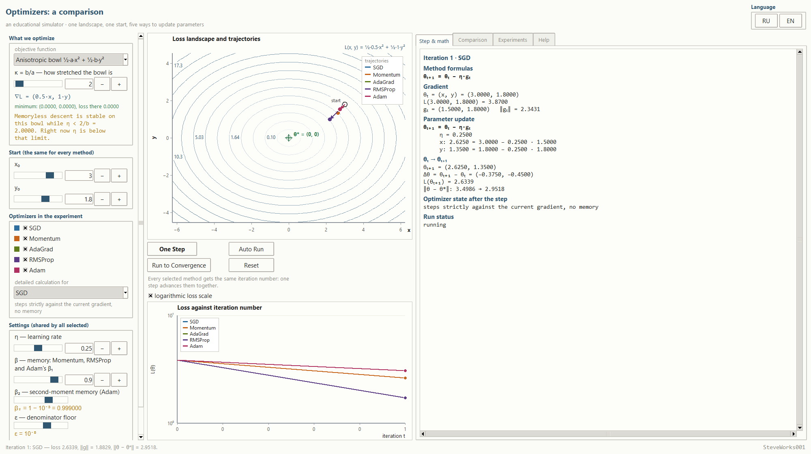
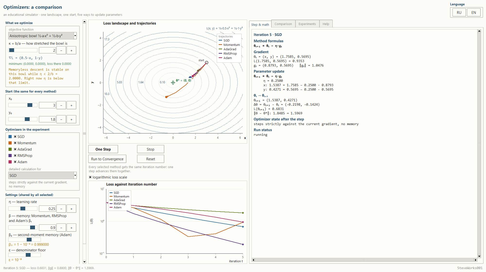
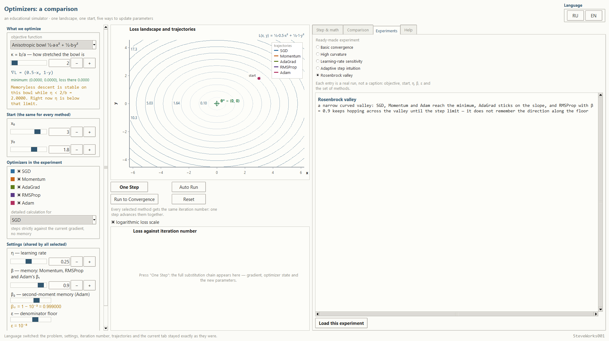
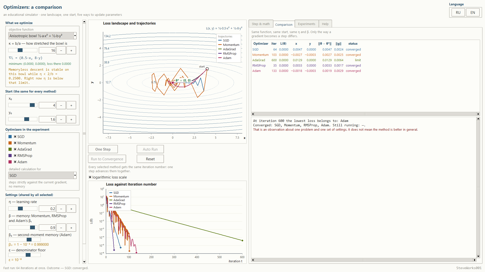
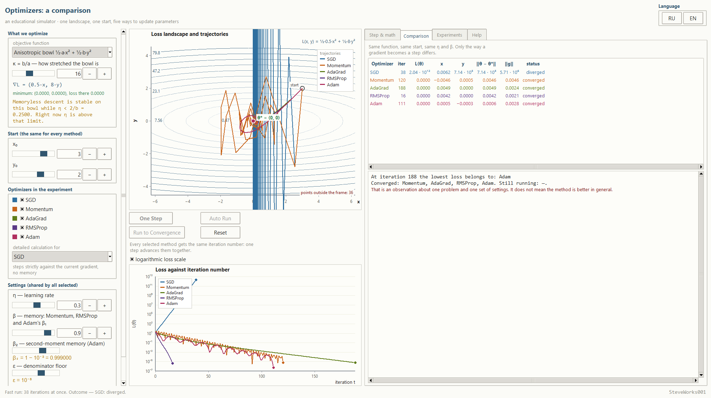
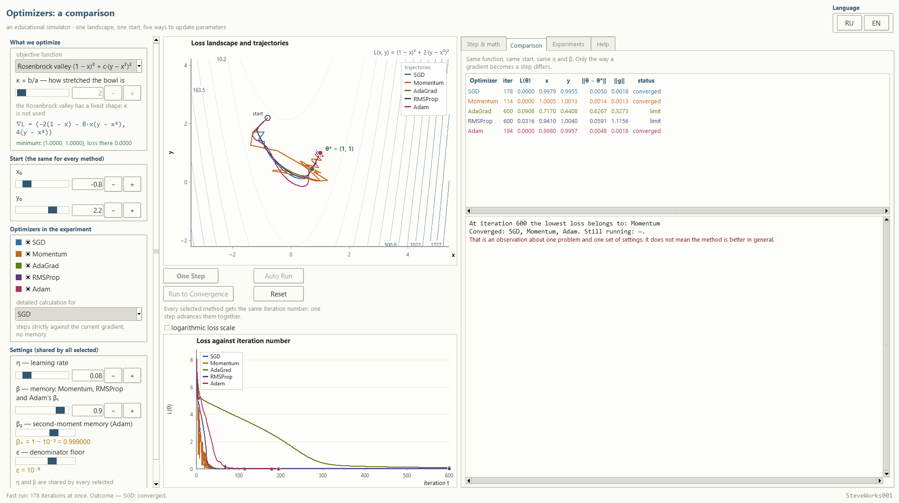
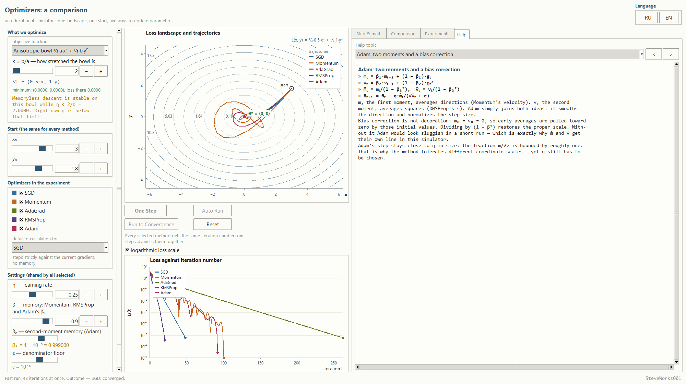
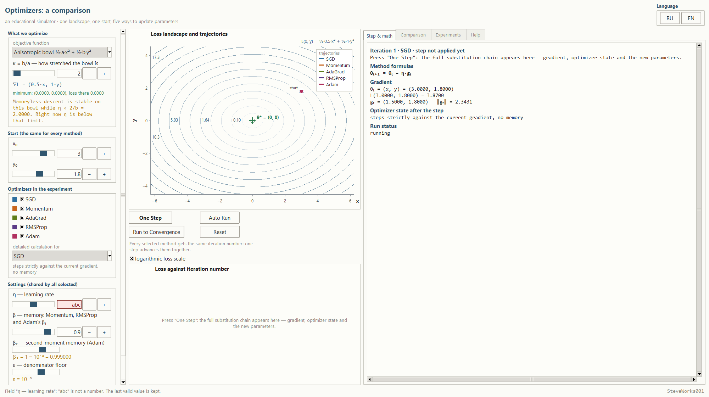

# Optimizers: Comparing Methods — An Educational Simulator

Russian version: [README_RU.md](README_RU.md).

Project 11 of 13 educational machine-learning simulators.
A single-file Python and Tkinter application: standard library only, no external
packages, no network and no dependency installation.

Here the subject is **not gradient descent on its own but the five ways to turn one
and the same gradient into a step**. One landscape, one starting point, one learning
rate — and five curves that part ways right after the first step:

```text
SGD → Momentum → AdaGrad → RMSProp → Adam
```

Every step is shown with its substitutions, every trajectory comes from a real run,
and any number on screen can be checked on paper.

---

## Purpose

A gradient answers the question "which way do the losses grow". A direction alone is
not enough: one still has to decide **how long the step should be** and **what to
remember** about the previous steps. That is exactly where the optimizers part — and
that is exactly what this program shows:

```text
parameters θ
      ↓
loss L(θ)
      ↓
gradient g
      ↓
optimizer (its own state: momentum, accumulated squares, a counter)
      ↓
update θ
      ↓
repeat — in the very same way as in the previous step
```

All five methods walk over the same loss function, from the same point and with the
same `η`. They differ only in what they do with the gradient. That is why the overlay
of trajectories is the main result of the program: it shows where the methods agree
and where their paths diverge.

### What this project does NOT cover

- no neural-network training: no dataset, no epochs, no backpropagation;
- no high-dimensional parameters — exactly two, `x` and `y`, so that the whole path
  stays visible;
- no optimizers beyond the five listed: Nesterov, AdaDelta, AdamW, Nadam, L-BFGS,
  RProp and second-order methods are absent on purpose;
- no verdict on "which method is better overall" — the program compares behaviour on
  one specific problem;
- no NumPy, SciPy, pandas, scikit-learn, matplotlib, TensorFlow, PyTorch, network
  access, databases or APIs.

Gradient descent as such is only recalled here; a separate project of the series is
devoted to it. This one goes a step further and answers the question "how do different
optimizers differ when their gradient is the same".

---

## Learning goals

- Understand that an optimizer is a rule for turning a gradient into a parameter
  increment, not "improved gradient descent".
- Read each of the five update rules line by line and see what exactly distinguishes
  them: memory of direction, memory of gradient magnitude, or both.
- Understand why accumulated velocity (Momentum) exists and why it damps the
  oscillations across a valley.
- Understand how an adaptive step size works: AdaGrad accumulates gradient squares
  without limit, RMSProp keeps only the recent ones — and see what that costs on a
  long run.
- Decompose Adam as the combination of both mechanisms and understand why it needs the
  **explicit** bias correction `m̂ₜ = mₜ/(1 − β₁ᵗ)`; nowhere in the program is it
  hidden.
- Understand what optimizer state is and why a reset must zero it completely,
  otherwise old moments would refer to different settings.
- See that `η` stays the primary setting even with adaptive methods: they rescale the
  step but do not cancel the stability limit.
- Learn to read a step's sign and length from a trajectory and to predict who arrives
  faster on **this** landscape.
- Understand how convergence differs from "hit the step limit" and from divergence, and
  how the program announces each of those states.

---

## Mathematics: one gradient, five update rules

### One problem for every method

All five optimizers work on the same function so that the comparison is honest.

**Anisotropic bowl** — the main example:

```text
L(x, y) = ½·a·x² + ½·b·y²        ∇L = (a·x, b·y)        minimum θ* = (0, 0)
a = 0.5,  b = a·κ,  κ = b/a — how stretched the bowl is
```

The curvature along `x` is held constant; only `b` changes. At `κ = 1` this is a
circular bowl, at `κ = 40` a long trough: almost flat along `x`, almost a wall along
`y`. The minimum is known exactly and is drawn as a cross on the landscape, so it is
always visible how far each method still is from it.

**Rosenbrock valley** — the second example, where one direction depends on the other:

```text
L(x, y) = (1 − x)² + c·(y − x²)²        minimum θ* = (1, 1)
∇L = (−2(1 − x) − 8·x·(y − x²),  4(y − x²)),   c = 2
```

This valley has a fixed shape, so `κ` is unavailable for it.

### The five update rules

These are the same five rules the "Step & math" tab prints for the selected method
(the program writes the multipliers without a dot — `β₁mₜ₋₁` rather than `β₁·mₜ₋₁`):

```text
SGD        θₜ₊₁ = θₜ − η·gₜ

Momentum   vₜ = β·vₜ₋₁ + gₜ,        θₜ₊₁ = θₜ − η·vₜ

AdaGrad    Gₜ = Gₜ₋₁ + gₜ²,         θₜ₊₁ = θₜ − η·gₜ/(√Gₜ + ε)

RMSProp    sₜ = β·sₜ₋₁ + (1−β)·gₜ², θₜ₊₁ = θₜ − η·gₜ/(√sₜ + ε)

Adam       mₜ = β₁·mₜ₋₁ + (1−β₁)·gₜ
           vₜ = β₂·vₜ₋₁ + (1−β₂)·gₜ²
           m̂ₜ = mₜ/(1−β₁ᵗ),  v̂ₜ = vₜ/(1−β₂ᵗ)
           θₜ₊₁ = θₜ − η·m̂ₜ/(√v̂ₜ + ε)
```

Accumulated quantities are kept per coordinate: `x` and `y` have their own `vₜ`, `Gₜ`,
`sₜ`, `mₜ`. The bias correction is written out explicitly and with the real iteration
number `t`, because in the first steps `1 − β₁ᵗ` and `1 − β₂ᵗ` are numbers of different
orders: with `β₁ = 0.9` and `β₂ = 0.999`, after four steps they are `0.3439` and
`0.003994`.

The `β` of Momentum and RMSProp and `β₁` of Adam are **one shared setting**, so that
"memory" means the same thing across the comparison. `β₂` and `ε` are set separately,
and not by typing a number but by stepping over the exponent: `β₂ = 1 − 10⁻ᵏ` at
k = 1…4 gives exactly four values — `0.9`, `0.99`, `0.999` and `0.9999` — and
`ε = 10⁻ᵏ` at k = 1…12 gives twelve, from `10⁻¹` to `10⁻¹²`. The left column labels
each setting with the exponent and the number together: `β₂ = 1 − 10⁻³ = 0.999000`
and `ε = 10⁻⁸`, while the calculation panel prints the short `β₂ = 0.999`. So
`0.999` here is not "almost one" but exactly `1 − 10⁻³`, and that is the number the
substitutions use.

`β₂` has one job, and the field names it: "β₂ — second-moment memory (Adam)". It is
the decay factor of the running average of squared gradients `vₜ`, and it appears
nowhere else: `RMSProp` averages the same squares but with the shared `β`. So `β₂`
moves only `Adam`, while `β` moves `Momentum`, `RMSProp` and the first moment of
`Adam`.

### One step with real numbers

Default starting values: `κ = 2` (so `a = 0.5`, `b = 1`), `θ₀ = (3.0000, 1.8000)`,
`η = 0.2500`. The first SGD step is exactly the arithmetic one can do by hand:

```text
θ₀ = (3.0000, 1.8000)
g₀ = (0.5·3.0000, 1·1.8000) = (1.5000, 1.8000)
θ₁ = (3.0000 − 0.2500·1.5000,  1.8000 − 0.2500·1.8000) = (2.6250, 1.3500)

L(θ₀) = ½·0.5·3.0000² + ½·1·1.8000² = 3.8700
L(θ₁) = ½·0.5·2.6250² + ½·1·1.3500² = 2.6339
```

On the same start Momentum makes **the very same first step**: `v₀ = 0`, so
`v₁ = β·0 + g₀ = g₀`. The paths part at the second step, where the accumulated velocity
is no longer equal to the current gradient. This is convenient to see on the
trajectory: the two lines split not at once but one turn later.

On the fourth Adam iteration the "Step & math" tab prints exactly what the number is
made of (same method, `θ₀`, `η`, `β`, `β₂` and `ε` as by default):

```text
θₜ = (x, y) = (2.2531, 1.0566)
L(2.2531, 1.0566) = 1.8272
gₜ = (1.1265, 1.0566)      ‖gₜ‖ = 1.5445

mₜ = β₁·mₜ₋₁ + (1 − β₁)·gₜ
   β₁ = 0.9000, β₂ = 0.999, t = 4
   x: 0.4459 = 0.9000 · 0.3703 + 0.1000 · 1.1265

m̂ₜ = mₜ/(1 − β₁ᵗ)
   1 − β₁ᵗ = 1 − 0.9000⁴ = 0.3439
   x: 1.29664 = 0.445914 / 0.3439

θₜ₊₁ = θₜ − η·m̂ₜ/(√v̂ₜ + ε)
   x: 2.0075 = 2.2531 − 0.2500 · 1.2966 / (√1.7429 + 10⁻⁸)
```

### Convergence, limit and divergence

The minimum counts as reached when **both** conditions hold at the same time:

```text
‖θ − θ*‖ < 0.005    and    ‖∇L‖ < 0.005
```

The first says how close, the second how flat the place is. The program never writes
"converged exactly": the table and the status line carry the actual numbers.

Besides convergence a run can end in three other ways, and every one of them is named
in words instead of a silent stop:

- **diverged** — the step cannot be applied honestly: the new coordinates would
  leave `10⁶`, and for the methods that carry memory the same check covers the
  accumulated quantities too — `Gₜ` for `AdaGrad`, `mₜ` and `vₜ` for `Adam`;
- **no progress** — the step stopped lowering the loss (a change smaller than `10⁻¹²`);
- **hit the 600-step limit** — the run was stopped by the counter, not because the
  method converged.

The last case matters educationally: a method that ran into the limit is not a loser —
it simply did not arrive within the allotted number of steps.

### Why η stays the primary setting

For the bowl `½·a·x² + ½·b·y²` plain descent is stable while

```text
η < 2/b
```

This limit is shown as a live number in the left panel, and the text changes when `η`
crosses it. At `κ = 40` (so `b = 20`) and `η = 0.25` the panel prints:

```text
Memoryless descent is stable on this bowl while η < 2/b = 0.1000.
Right now η is above that limit.
```

Adaptive methods do not cancel this limit: they divide the step by an accumulated
gradient magnitude, so `η` remains a multiplier in front of the whole expression. Raise
`η` enough — and `SGD` and `Momentum` will diverge while `AdaGrad`, `RMSProp` and
`Adam` keep reducing the loss. That is not "they are better"; it is a different place
where the tunable parameter starts to hurt.

---

## Interface and how to use it

The window is split into three columns; at the bottom is the status line, in the
bottom-right corner the author label.

**Left** — "What we optimize": the choice of objective, `κ = b/a`, the loss formula,
its gradient, the exact position of the minimum and the stability-limit note. Below —
"Start (the same for every method)" with `x₀` and `y₀`, then "Optimizers in the
experiment" — five check boxes and the choice of the method whose calculation is shown
in detail — and "Settings (shared by all selected)" with `η`, `β`, `β₂` and `ε`.

**Center** — the "Loss landscape and trajectories" canvas: contour lines, the cross of
the minimum labelled `θ*`, the start point, the current positions of the methods and
their trajectories in one coordinate system. Under it — four buttons: `One Step`,
`Auto Run` (it reads `Stop` while a run is going), `Run to Convergence` and `Reset`;
next to them the "logarithmic loss scale" switch, and below that the "Loss against
iteration number" chart.

**Right** — four tabs: "Step & math", "Comparison", "Experiments", "Help".

### Three run modes

- **`One Step`** — the main mode. One click moves **every** selected method by exactly
  one iteration: the counter is shared, so a line `Iteration 4 · Adam` means the others
  are at their fourth as well. The calculation panel is rebuilt with the real
  substitutions, the trajectory grows, the table updates.
- **`Auto Run`** — the same steps automatically, with a 120 ms pause; the button turns
  into `Stop`, and stopping is possible at any moment.
- **`Run to Convergence`** — finishes the run in batches of 40 steps so that the
  interface does not freeze.

Before the first click the "Step & math" tab shows the **upcoming** step: the numbers
are already on screen and can be checked before they are applied.

### The landscape canvas

Everything drawn on the canvas comes from the calculation: contour lines from the
function, points from the accumulated trajectories, the arrow from the last completed
step. There are no decorative lines. If a method leaves the visible area, its points
are not silently clipped — a counter appears instead, "points outside the frame: N".

### The loss chart

The horizontal axis is the iteration number, the vertical axis is the loss. Curves are
built from the actual history of each run, not from an idealised scheme. A linear scale
shows the difference between `10⁻²` and `10⁻⁹` badly, which is why a logarithmic-scale
switch sits next to it: on the log scale it is visible that "everyone converged" and
"everyone converged in the same number of steps" are different statements.

### The "Comparison" tab

A table of eight columns — precisely the numbers by which the methods differ:

```text
Optimizer | iter | L(θ) | x | y | ‖θ − θ*‖ | ‖g‖ | status
```

The outcome column shortens the long names: `limit` instead of "hit the 600-step
limit" and `no progress` instead of "steps stopped lowering the loss"; the full
wordings are given by the status line and the "Step & math" tab.

Below it — a summary: who has the smallest loss, who has already converged, who is
still running, and the mandatory note that this is an observation of one problem and
one set of settings.

What follows is **a recorded run, not a guarantee**: these are the numbers the
table showed after `Run to Convergence` on the full default settings (`κ = 2`,
`θ₀ = (3.0, 1.8)`, `η = 0.25`, `β = 0.9`, `β₂ = 0.999`, `ε = 10⁻⁸`). Rebuilding the
same settings reproduces them — but only under those settings:

| Method | iterations | ‖θ − θ*‖ | ‖g‖ | outcome |
|---|---|---|---|---|
| SGD | 48 | 0.0049 | 0.0025 | converged |
| Momentum | 100 | 0.0005 | 0.0004 | converged |
| AdaGrad | 262 | 0.0049 | 0.0024 | converged |
| RMSProp | 20 | 0.0038 | 0.0019 | converged |
| Adam | 92 | 0.0008 | 0.0008 | converged |

There is food for thought here: `RMSProp` is the fastest (20 steps), `AdaGrad` the
slowest (262), and `Momentum` took more steps than `SGD` (100 against 48) yet
stopped closer to the minimum. The order of places belongs to this run: on another
bowl, in the Rosenbrock valley or at another `η` it changes, and the guided
experiments below assemble exactly those cases.

### The "Step & math" tab

The full arithmetic of the last step of the selected method: the rule of the method,
the gradient, every accumulated quantity with its numbers substituted, the bias
correction, and the final update coordinate by coordinate. Numbers are printed to four
digits, and very large or very small ones with an exponent, so that "0.0000" never
pretends to be zero.

### Ready-made experiments

Five settings that define not a caption but a real run: the function, the start point,
`η`, `β`, `β₂`, `ε` and the set of methods.

| Experiment | What is visible |
|---|---|
| Basic convergence | gentle bowl `κ = 2`, `η = 0.25`: all five arrive, only the iteration count differs |
| High curvature | the bowl is stretched 16 times, `η·b = 1.6`: `SGD` flips the sign of `y` on every step, `Momentum` damps those hops, `AdaGrad` only reaches the 600-step limit |
| Learning-rate sensitivity | `η = 0.30` is above the stability limit (`2/b = 0.25`): `SGD` diverges, the others continue |
| Adaptive step intuition | `η = 0.05`, a long run: `AdaGrad`'s denominator only grows, and it freezes about two units short of the minimum |
| Rosenbrock valley | a curved valley: `AdaGrad` sticks on the slope, `RMSProp` hops across the valley until the very end |

The button under the list loads the chosen setting and restarts the run: the methods
start from `θ₀` with empty memory, and counting begins with `One Step`, `Auto Run` or
`Run to Convergence`. So the comparison comes from the same numbers as the rest of the
screen.

### Fields and limits

Every field is restricted to a meaningful range — so that one cannot build an
experiment that explains nothing:

```text
η            0.002 … 0.500     (default 0.250)
β            0.000 … 0.990     (default 0.900)
β₂           1 − 10⁻ᵏ, k = 1…4 (default 0.999)
ε            10⁻ᵏ, k = 1…12    (default 10⁻⁸)
κ            1.0 … 40.0        (default 2.0)
x₀, y₀       bowl: ±5 of (0, 0); Rosenbrock valley: ±2.6 of (1, 1),
             that is −1.6 … 3.6 per coordinate (default 3.0 and 1.8)
```

The `x₀` and `y₀` bounds belong to the problem, not to the fields: `±5` is the
bowl, the Rosenbrock valley spans half as much around a different centre, so
switching to the valley narrows the frame to `−1.6 … 3.6` and squeezes the start
point already chosen into it. Outside the frame the field keeps its value and the
status line answers, for example, `Field "x₀": 4 is outside [-1.6; 3.6]. The last
valid value is kept.`

A comma is accepted as a decimal separator, and a real minus sign `−` is read like
an ordinary one. A non-number or an out-of-range value
produces a message in the status line and keeps the last correct values. Any edit of
the settings restarts the run and zeroes the state of every optimizer: old accumulated
moments must not refer to a different function.

### Language

The interface is translated on the fly, without a restart: labels, buttons, chart axes
and legends, statuses, table headings, help texts and experiment descriptions.
Switching preserves the problem, the selected methods, the settings, the iteration
number, the progress of the experiment and the open tab. The mathematical notation
(`θ`, `η`, `β`, `∇L`, `m̂ₜ`, `√v̂ₜ`) does not depend on the language.

---

## Guided experiments

The five experiments below use only actions this interface really performs, and they
quote only numbers the application prints after those actions. The ready-made
entries of the "Experiments" tab are documented separately under "Ready-made
experiments"; here everything is assembled by hand. `Reset` starts any of them over:
it returns the run to `θ₀`, zeroes the state of every method and prints
"Experiment restarted: θ₀, each optimizer's state, counters, loss history and
trajectories are back to launch values."

**1. The first step is shared, with two exceptions.** Change: leave everything at
the defaults (bowl `κ = 2`, `θ₀ = (3.0, 1.8)`, `η = 0.25`, `β = 0.9`) and press
`One Step`.
Observe: after that step `SGD` and `Momentum` stand in the same point
`(2.6250, 1.3500)` with loss `2.6339` — Momentum has `v₀ = 0`, so `v₁ = g₀`.
`AdaGrad` and `Adam` step to `(2.7500, 1.5500)`, because their denominator on the
first step is `|g|` and the step is exactly `η` in magnitude, while `RMSProp` goes
furthest of all, to `(2.2094, 1.0094)`: its `s₁ = (1 − β)·g²` is smaller than `g²`.
The second step is where `SGD` and `Momentum` part: `SGD` gives `(2.2969, 1.0125)`,
Momentum `(1.9594, 0.6075)`.
Think about: if an optimizer is a rule rather than a direction, in exactly which
number of the second step does the memory become visible, and why the very first
`RMSProp` step is longer than the `AdaGrad` one although both divide by an
accumulated square.

**2. Who arrives fastest is a property of one run.** Change: put all five check
boxes back on, press `Run to Convergence` and open the "Comparison" tab.
Observe: `RMSProp` — 20 steps, `SGD` — 48, `Adam` — 92, `Momentum` — 100, `AdaGrad`
— 262, and all five carry the outcome `converged`. Their `‖θ − θ*‖` are `0.0038`,
`0.0049`, `0.0008`, `0.0005` and `0.0049`, and their `‖g‖` are `0.0019`, `0.0025`,
`0.0008`, `0.0004` and `0.0024`. The method that took thirteen times as many steps
as `RMSProp` got exactly the same status.
Think about: what the status actually measures — the step count or the closeness to
the minimum under two tolerances — and which column of the table is the only honest
measure of "speed" on this problem.

**3. One η for five: the stability limit.** Change: set `κ = 16`, `x₀ = 3.0`,
`y₀ = 2.0`, `η = 0.30` — the ready-made entry "Learning-rate sensitivity" does the
same — then press `Run to Convergence`.
Observe: the left panel prints "Memoryless descent is stable on this bowl while
η < 2/b = 0.2500. Right now η is above that limit." (at `κ = 16` the value is
`b = 8`). `SGD` stops after 38 honestly applied steps with the word `diverged`:
`θ = (0.0062, 714324.1802)`, `L = 2.04·10¹²`; the next step failed the `10⁶` check,
so it was neither drawn nor added to the table. The other four arrive: `RMSProp` in
16, `Adam` in 111, `Momentum` in 120, `AdaGrad` in 188 steps.
Think about: what those four arrivals have in common that `SGD` lacks, given that
the gradient is one and the same for all of them and `η` is shared as well.

**4. A denominator that only grows.** Change: set `κ = 4`, `x₀ = 4.0`, `y₀ = 2.5`,
`η = 0.05` (the ready-made entry "Adaptive step intuition"), then run to the end.
Observe: `AdaGrad` hits the step limit with `‖θ − θ*‖ = 2.0268`, `‖g‖ = 1.6123` and
`L = 1.3415`, and the table labels it with the short word `limit` — the status line
spells it out as "hit the 600-step limit". The others arrive: `Momentum` in 93,
`RMSProp` in 109, `Adam` in 193, `SGD` in 265 steps. `AdaGrad`'s `Gₜ` is a sum of
the squares of every gradient so far and has no way to shrink.
Think about: at which `η` this kind of memory stops being help and becomes a brake,
and why `RMSProp`, which puts the same squared gradient into its denominator, is
free of it.

**5. The Rosenbrock valley and the narrowing start fields.** Change: pick
"Rosenbrock valley (1 − x)² + c·(y − x²)²" in the objective list and try to type
`x₀ = 4`; then load the ready-made entry "Rosenbrock valley" (start `(−0.8, 2.2)`,
`η = 0.08`) and run to the end.
Observe: the field answers `Field "x₀": 4 is outside [-1.6; 3.6]. The last valid
value is kept.` — the valley spans `±2.6` around `(1, 1)` instead of the bowl's
`±5`, and switching the objective squeezes the already chosen start into the new
frame. The left panel also disables the `κ` field with the note "the Rosenbrock
valley has a fixed shape: κ is not used" and labels the minimum
"minimum: (1.0000, 1.0000), loss there 0.0000". In the run: `SGD` in 178, `Momentum`
in 114 and `Adam` in 194 steps — `converged`; `AdaGrad` hits the 600-step limit at
`‖θ − θ*‖ = 0.6267` with `L = 0.0908`; `RMSProp` also hits the limit, at
`‖θ − θ*‖ = 0.0591` while `‖g‖ = 1.1156` — the point stands almost at the bottom of
the valley while the gradient is far from zero.
Think about: why the second convergence criterion has to exist separately from the
first one, and which of the two arrivals in this experiment in fact never got there.

---

## Installation and launch

The application is one file; no build and no dependency installation is needed.

Windows:

```bash
python optimizers_lab.py
```

macOS and Linux:

```bash
python3 optimizers_lab.py
```

The window opens at `max(1330, 92 % of the screen width)` by
`max(760, 90 % of its height)` and asks the window manager to zoom it; on a typical
desktop that is indeed 92 % and 90 %, and a manager may refuse — then the size is
set by hand. It can be shrunk to about `1290 × 700`, and on a short display that
floor automatically becomes smaller than the screen. The width 1290 is dictated by
the layout itself: the three columns ask for at least 330, 430 and 486 pixels, the
left column and the tabs scroll, so nothing gets cut off.

Quick start: at launch the anisotropic bowl `κ = 2` already stands with the start
`(3.0, 1.8)`, `η = 0.25`, `β = 0.9`, `β₂ = 0.999`, `ε = 10⁻⁸`, and all five methods
are checked. The status line reads `Ready. Set the bowl and η, then press "One Step"
or "Run to Convergence".`, and the "Step & math" tab shows the upcoming first step
under the heading `Iteration 1 · SGD · step not applied yet`. Press
`Run to Convergence` and open "Comparison" — that reproduces the very run whose
numbers are printed above.

The language switch is in the window header: **RU** / **EN**.

---

## Screenshots

The frames were captured from the application actually running in a 2000 × 1120
pixel window. The English and Russian series show the same states, so the frames
can be compared line by line; the numbers in the captions are the ones the
application printed at the moment of capture. Long lines in the right-hand panel
run under a horizontal scrollbar, so a frame does not always show a whole line.

**The window at startup.** An anisotropic bowl `κ = 2`, start `(3.0, 1.8)`,
`η = 0.25`, `β = 0.9`, `β₂ = 0.999`, `ε = 10⁻⁸`, all five methods checked. The
status line reads `Language switched: the problem, settings, iteration number,
trajectories and the current tab stayed exactly as they were.` — the frame was
taken right after the EN button was pressed. The panel on the right still shows
the heading `Iteration 1 · SGD · step not applied yet`.



**Run to convergence on the "Comparison" tab.** The same bowl and the same
`η = 0.25`: SGD converges in 48 iterations, Momentum in 100, AdaGrad in 262,
RMSProp in 20 and Adam in 92 — every row of the table reads `converged`. Below
the table the application writes whose loss is the smallest (`At iteration 262
the lowest loss belongs to: Momentum`) and, in red, that this is an observation
about one problem and one set of settings.



**One SGD step with every substitution shown.** The "Step & math" tab right
after `One Step`: gradient `gₜ = (1.5000, 1.8000)` at `‖gₜ‖ = 2.3431`, then
`x: 2.6250 = 3.0000 − 0.2500 · 1.5000` and `y: 1.3500 = 1.8000 − 0.2500 · 1.8000`,
the step `Δθ = (−0.3750, −0.4500)`, the new loss `L(θₜ₊₁) = 2.6339` and the
distance to the minimum `3.4986 → 2.9518`.



**An auto run caught in the middle.** The `Auto Run` button has become `Stop`,
iteration 5 is on the screen: the trajectories are cut short, the loss plot
reaches 5, and the status line reads `Iteration 5: SGD — loss 0.6831, ‖g‖ = 0.8800,
‖θ − θ*‖ = 1.5969.`



**The "Experiments" tab.** The fifth entry, "Rosenbrock valley", is selected; the
note under the list says each entry is a real run rather than a caption, and the
panel to the right prints its learning goal. `Load this experiment` runs nothing:
it sets the objective, the start, `η`, `β`, `ε` and the set of methods. The status
line still carries the language-switch notice, because switching to English was
the last action before the shot.



**High curvature: SGD zigzags.** The preset sets `κ = 16`, `η = 0.2` and the
start `(4.0, 1.6)`. On the landscape SGD hops across the valley while Momentum
draws an orange loop; in the table AdaGrad runs into the 600-step limit still
0.0129 away from the minimum, while the other four converge — RMSProp fastest, in
35 iterations.



**η above the stability limit: SGD diverges.** The "Learning-rate sensitivity"
preset sets `κ = 16` and `η = 0.3`, while memoryless descent is stable only below
`2/b = 0.2500`; the left column warns about that in yellow. SGD stops at iteration
38 with status `diverged` and loss `2.04 · 10¹²`, whereas the other four methods
converge.



**Rosenbrock valley: the limit instead of convergence.** The preset sets
`η = 0.08` and the start `(−0.8, 2.2)`, and the logarithmic loss checkbox is off,
so the loss plot is linear. SGD, Momentum and Adam converge in 178, 114 and 194
iterations, while AdaGrad and RMSProp run into the 600-step limit with losses
0.0908 and 0.0316: they did not converge, but they did not diverge either.



**The "Help" tab.** The section `Adam: two moments and a bias correction` is
open: four formulas of the method and the reason `m̂ₜ` and `v̂ₜ` exist at all.
There are seventeen sections, reachable through the dropdown or the two arrows.



**Input validation.** The `η` field contains `abc`: the field is outlined in red,
the slider and the value stay at `0.25`, and the status line reads `Field "η —
learning rate": "abc" is not a number. The last valid value is kept.` The same
holds for `κ`, `x₀`, `y₀` and `β`; the `β₂` and `ε` controls are sliders without
an entry field, so their values simply clamp at the limit.



---

## Requirements

- Python 3.8 or newer.
- Tkinter — included in the official Python builds for Windows and macOS; in some
  Linux distributions it is installed separately as the `python3-tk` package.
- Standard library only: `math`, `tkinter`, `tkinter.ttk`, `tkinter.font`.
- Not used: NumPy, pandas, SciPy, matplotlib, Pillow, TensorFlow, PyTorch, Keras,
  scikit-learn and any `pip` packages.
- No network connection is needed: all mathematics is computed on the spot.

The application is designed for a desktop screen. The left column scrolls vertically,
the "Step & math" and "Help" tabs scroll in both directions, and the comparison table
scrolls horizontally, so with a short or narrow window the content goes under a scroll
bar rather than being cut off.

---

## Limitations

- Exactly **five** methods are compared: SGD, Momentum, AdaGrad, RMSProp, Adam.
  Nesterov, AdaDelta, AdamW, Nadam, L-BFGS, RProp and second-order methods are not
  implemented and are not planned.
- There are exactly **two** parameters; the function and its gradient are known
  analytically: there is no numerical differentiation and no automatic differentiation.
- This is not model training: no dataset, no mini-batches, no sampling, no epochs and
  no generalisation. The loss is the value of a formula at a point.
- Convergence is checked against fixed tolerances (`‖θ − θ*‖ < 0.005` and
  `‖∇L‖ < 0.005`) — the application does not promise "exactly at the minimum".
- A run is limited to 600 steps, and divergence is a step whose new coordinates or
  accumulated sums leave `10⁶`. A method that hits the limit is marked with the short
  `limit`, not `converged`.
- The `β` of Momentum and RMSProp and `β₁` of Adam are one shared setting: the
  comparison is fairer this way, but tuning the memory of each method separately is
  not available here.
- Numbers are computed with ordinary `float` precision: on very long runs the
  accumulated sums (`Gₜ`, `vₜ`) themselves decide when a step stops lowering the loss.
- Graphical interface only: there is no console mode, API or batch run.
- No save and load: state is not written to files and charts are not exported.
- Two interface languages: Russian and English.

---

## Educational note

The simulator exists to show **the difference between the update rules**, not to decide
which optimizer is "the best". The order of places in the comparison table depends on
the chosen function, the start point and `η`: on a gentle bowl one set wins, in the
Rosenbrock valley another, and at a large `η` some methods simply diverge. Individual
conventions are chosen for clarity: the convergence tolerances, the 600-step limit, the
`10⁶` divergence boundary, the shared `β` for three methods and the exponent notation
for very large and very small numbers decide when a run counts as finished and how it
is displayed, while real systems use other criteria. The default values were tuned to
the two specific functions here, not taken from model-training practice.

---

## What to know beforehand

**Strictly required:** Python 3 with Tkinter and launching one file from the command
line. No `pip` packages, no network, no external data, no settings files.

**Mathematics:** the derivative of one variable at a concrete point and the meaning
of a gradient as a pair of numbers `(a·x, b·y)`; substituting numbers into
`½·a·x² + ½·b·y²` and into `−2(1 − x) − 8·x·(y − x²)`; addition, multiplication and
a power such as `0.999⁴`. No matrices, integrals or numerical differentiation: the
gradient in this program is given by a formula, not by a difference quotient. The
index `t` in `mₜ`, `vₜ`, `Gₜ`, `sₜ` is the iteration number, so all five rules are
ordinary recurrences that can be walked on paper step by step — which is exactly
what the "Step & math" tab does.

**Useful but not required:** project 4 "Gradient Descent" — there the rule is single,
`θₜ₊₁ = θₜ − η·gₜ`, and there is no memory at all, so this project builds directly on
top of it; project 8 "Loss Functions" — there `L` appears as a penalty for a
prediction, while here `L` is the value of a formula at a point; project 5
"Backpropagation" — there the gradient is obtained from a network, here it is
substituted. None of them has to be completed before opening this application.

**On the Python version:** the "Requirements" section names Python 3.8 or newer. All
the checks for this release ran on the only version available on this machine —
Python 3.12.10 with Tk 8.6. The application does not check the version and running it
under other versions was not tested — that is declared compatibility, not a verified
guarantee.

---

## Place in the series

Project 11 of 13. The order is not strict: every project runs on its own and reads
nothing from its neighbours. What follows are only the links that exist by content.

| Project | Link by content |
|---|---|
| 2 — Perceptron | there the update is set by the sign of an error and has no memory; the same topic of a step rule, but on a smooth function and with five kinds of memory |
| 4 — Gradient Descent | there `θₜ₊₁ = θₜ − η·gₜ` is the only rule; here it joins the comparison as one of five |
| 5 — Backpropagation | there the gradient is produced by a backward pass through a network; here it is given analytically and the argument is only about the update |
| 6 — Neural Network Training | there a run is measured in epochs over a dataset; here the counter is iterations over one formula |
| 8 — Loss Functions | there one chooses the shape of the penalty over data; here the penalty is fixed by the formula and what is chosen is the step rule |
| 10 — Overfitting | there complexity is the number of model coefficients; here "complexity" is how much memory an optimizer carries, and data are not involved |

---

## Developer

**Developer: SteveWorks001**

---

## License

The application is distributed under the MIT license. The full text is in the
[`LICENSE`](LICENSE) file next to this README.
