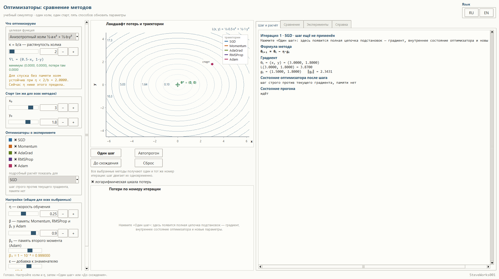
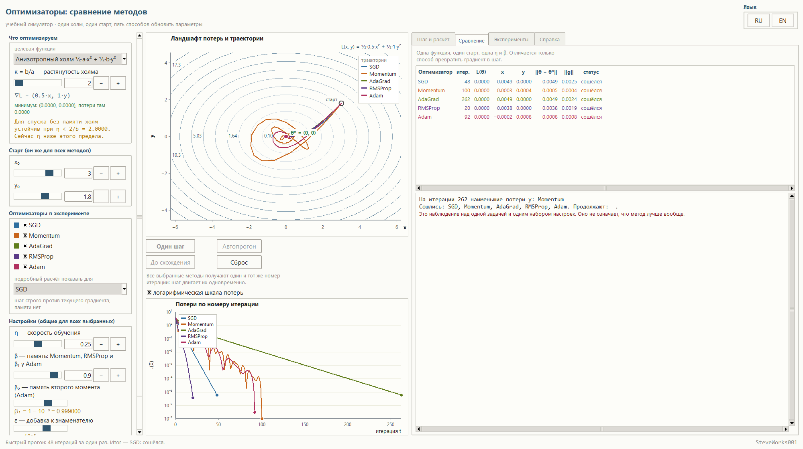
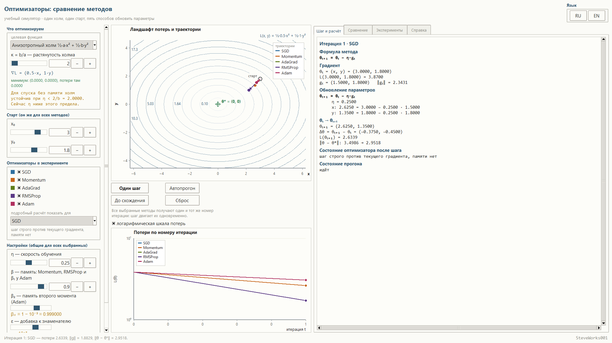
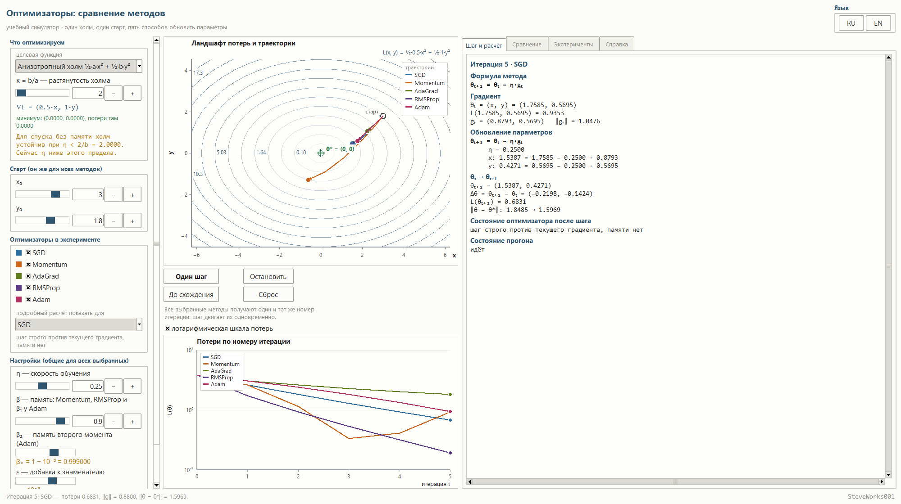
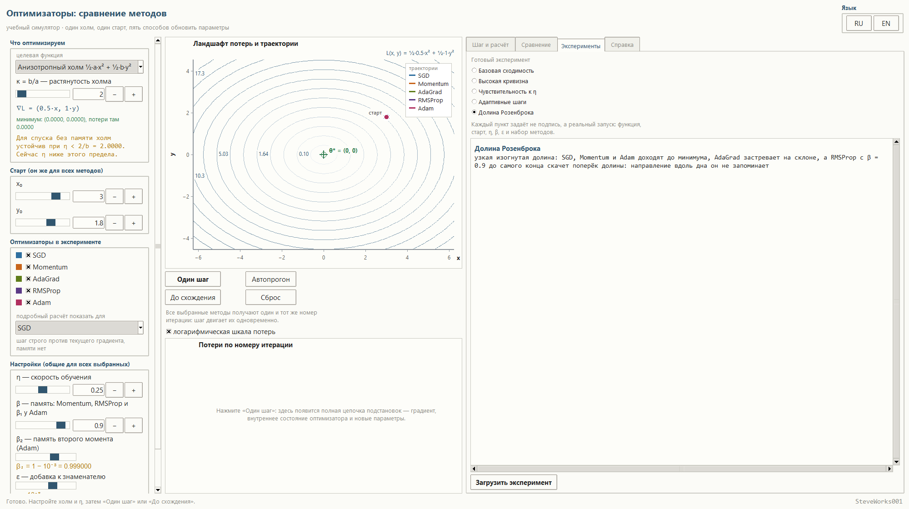
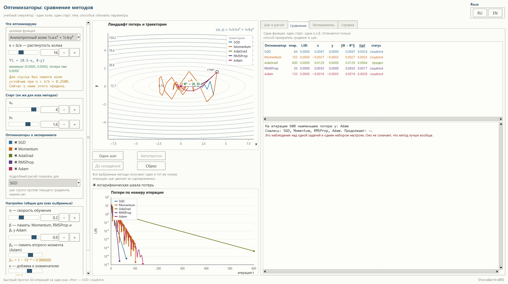
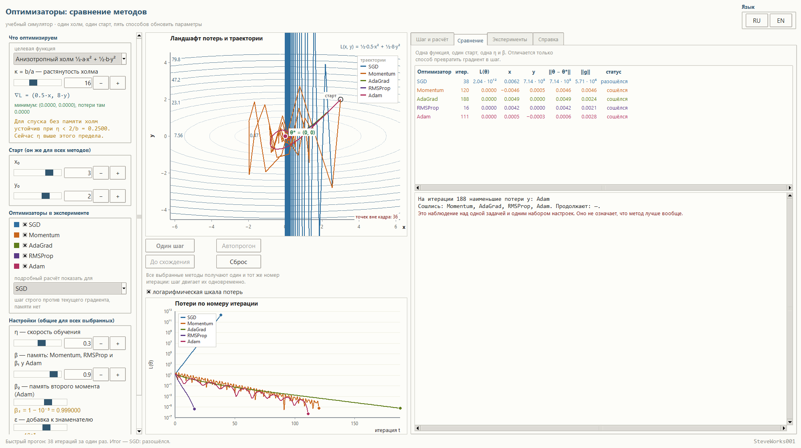
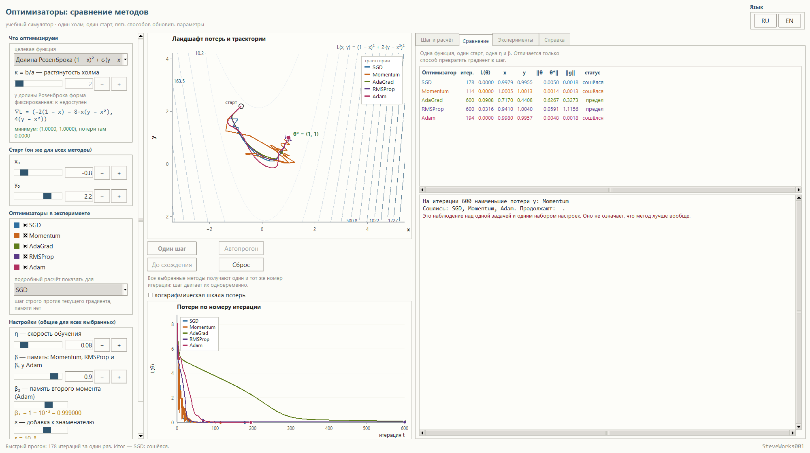
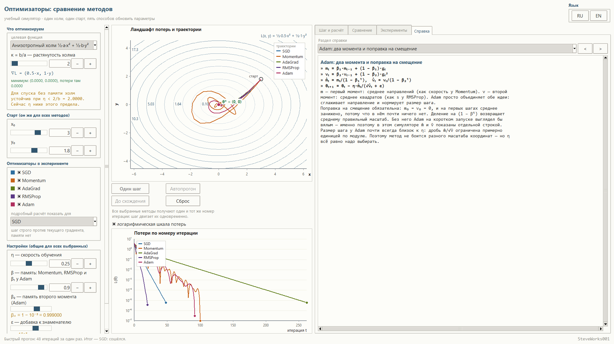
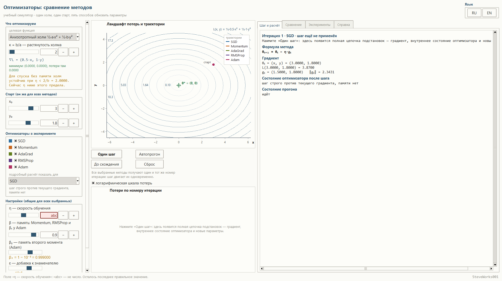

# Оптимизаторы: сравнение методов — учебный симулятор

Проект 11 из 13 учебных симуляторов по машинному обучению.
Однофайловое приложение на Python и Tkinter: только стандартная библиотека,
без внешних пакетов, без сети и без установки зависимостей.

Здесь сравнивают **не градиентный спуск самого по себе, а пять способов
превратить один и тот же градиент в шаг**. Один холм, одна стартовая точка, одна
скорость обучения — и пять кривых, которые расходятся сразу же после первого шага:

```text
SGD → Momentum → AdaGrad → RMSProp → Adam
```

Каждый шаг показан с подстановками, каждая траектория взята из настоящего
расчёта, и любое число можно проверить на бумаге.

---

## Назначение

Градиент отвечает на вопрос «куда расти потерям». Но одного направления мало:
надо решить, **какой величины шаг** сделать в эту сторону и **что помнить** о
предыдущих шагах. Именно здесь оптимизаторы расходятся — и именно это здесь и
показано:

```text
параметры θ
      ↓
потери L(θ)
      ↓
градиент g
      ↓
оптимизатор (своё состояние: момент, накопленные квадраты, счётчик)
      ↓
обновление θ
      ↓
повторить — тем же самым способом, что и в предыдущем шаге
```

Пять методов идут по одной и той же функции потерь, из одной и той же точки и с
одной и той же `η`. Разница только в том, что они делают с градиентом. Поэтому
наложение траекторий и есть главный результат: видно, где методы согласны и где
их пути расходятся.

### Чего в этом проекте нет

- нет обучения нейросетей: ни датасета, ни эпох, ни обратного распространения
  ошибки;
- нет многомерных параметров — ровно два, `x` и `y`, чтобы путь было видно целиком;
- нет оптимизаторов сверх перечисленных пяти: Nesterov, AdaDelta, AdamW, Nadam,
  L-BFGS, RProp и методов второго порядка здесь нет намеренно;
- нет сравнения «какой метод лучше вообще» — программа сравнивает поведение на
  одной конкретной задаче;
- нет NumPy, SciPy, pandas, scikit-learn, matplotlib, TensorFlow, PyTorch, сети,
  баз данных и API.

Градиентный спуск как таковой здесь только вспоминается: ему посвящён отдельный
проект серии. Этот шаг идёт дальше — он отвечает на вопрос «чем разные
оптимизаторы отличаются, если градиент у них один и тот же».

---

## Учебные цели

- Понять, что оптимизатор — это правило превращения градиента в приращение
  параметров, а не «улучшенный градиентный спуск».
- Разобрать построчно каждый из пяти способов обновления и увидеть, чем именно
  они различаются: памятью о направлении, памятью о величине градиента или и тем
  и другим.
- Понять, зачем нужна накопленная скорость (Momentum) и почему она гасит
  колебания поперёк долины.
- Понять, как устроен адаптивный размер шага: AdaGrad копит квадраты градиентов
  без ограничения, RMSProp — только последние, и к чему это приводит на длинном
  прогоне.
- Разобрать Adam как сочетание обоих механизмов и понять, зачем ему **явная**
  поправка на смещение `m̂ₜ = mₜ/(1 − β₁ᵗ)`; в программе она нигде не спрятана.
- Понять, что такое состояние оптимизатора и почему сброс обязан обнулять его
  целиком, иначе старые моменты отнесутся к другим настройкам.
- Увидеть, что `η` остаётся главной настройкой и при адаптивных методах:
  адаптивные способы меняют величину шага, но не отменяют предела устойчивости.
- Научиться читать знак и длину шага по траектории и предсказывать, кто дойдёт
  быстрее на **этом** холме.
- Понять, чем сходимость отличается от «предела шагов» и от расхождения, и как
  приложение объявляет каждое из этих состояний.

---

## Математика: один градиент, пять правил обновления

### Общая задача для всех методов

Все пять оптимизаторов работают с одной и той же функцией, чтобы сравнение было
честным.

**Анизотропный холм** — основной пример:

```text
L(x, y) = ½·a·x² + ½·b·y²        ∇L = (a·x, b·y)        минимум θ* = (0, 0)
a = 0.5,  b = a·κ,  κ = b/a — насколько холм растянут
```

Кривизна по `x` держится постоянной, меняётся только `b`. При `κ = 1` это
круговая чаша, при `κ = 40` — длинный жёлоб: по `x` почти плоско, по `y` почти
стена. Минимум известен точно и нарисован на холсте крестом, поэтому всегда
видно, насколько далеко от него каждый метод.

**Долина Розенброка** — второй пример, там, где одно направление зависит от
другого:

```text
L(x, y) = (1 − x)² + c·(y − x²)²        минимум θ* = (1, 1)
∇L = (−2(1 − x) − 8·x·(y − x²),  4(y − x²)),   c = 2
```

У этой долины форма фиксированная, поэтому `κ` для неё недоступен.

### Пять правил обновления

Это те же пять правил, что печатает панель «Шаг и расчёт» для выбранного метода
(в программе множители записаны слитно — `β₁mₜ₋₁`, а не `β₁·mₜ₋₁`):

```text
SGD        θₜ₊₁ = θₜ − η·gₜ

Momentum   vₜ = β·vₜ₋₁ + gₜ,        θₜ₊₁ = θₜ − η·vₜ

AdaGrad    Gₜ = Gₜ₋₁ + gₜ²,         θₜ₊₁ = θₜ − η·gₜ/(√Gₜ + ε)

RMSProp    sₜ = β·sₜ₋₁ + (1−β)·gₜ², θₜ₊₁ = θₜ − η·gₜ/(√sₜ + ε)

Adam       mₜ = β₁·mₜ₋₁ + (1−β₁)·gₜ
           vₜ = β₂·vₜ₋₁ + (1−β₂)·gₜ²
           m̂ₜ = mₜ/(1−β₁ᵗ),  v̂ₜ = vₜ/(1−β₂ᵗ)
           θₜ₊₁ = θₜ − η·m̂ₜ/(√v̂ₜ + ε)
```

Накопленные величины ведутся отдельно для каждой координаты: у `x` и `y` свои
`vₜ`, `Gₜ`, `sₜ`, `mₜ`. Поправка на смещение пишется явно и с настоящим номером итерации `t`,
потому что на первых шагах `1 − β₁ᵗ` и `1 − β₂ᵗ` — числа разного порядка: при
`β₁ = 0.9` и `β₂ = 0.999` после четырёх шагов это `0.3439` и `0.003994`.

β у Momentum, RMSProp и β₁ у Adam — **одна общая настройка**, чтобы «момент»
означал в сравнении одно и то же. `β₂` и `ε` заданы отдельно и не вводом числа, а
шагом по показателю: `β₂ = 1 − 10⁻ᵏ` при k = 1…4 даёт ровно четыре значения —
`0.9`, `0.99`, `0.999` и `0.9999`, — а `ε = 10⁻ᵏ` при k = 1…12 даёт двенадцать
значений от `10⁻¹` до `10⁻¹²`. Левая колонка подписывает настройку показателем и
числом сразу: `β₂ = 1 − 10⁻³ = 0.999000` и `ε = 10⁻⁸`, а панель расчёта печатает
короткое `β₂ = 0.999`. Так что `0.999` в этом опыте — не «почти один», а ровно
`1 − 10⁻³`, и в подстановках он участвует именно этим числом.

Назначение у `β₂` одно, и оно названо на самом поле: «β₂ — память второго момента
(Adam)». Это множитель затухания накопленного среднего квадратов градиента `vₜ`, и
больше нигде `β₂` не участвует: `RMSProp` считает то же среднее квадратов, но по
общей `β`. Поэтому `β₂` двигает только `Adam`, а `β` — и `Momentum`, и `RMSProp`, и
первый момент `Adam`.

### Один шаг на числах

Стартовые значения по умолчанию: `κ = 2` (значит `a = 0.5`, `b = 1`),
`θ₀ = (3.0000, 1.8000)`, `η = 0.2500`. Первый шаг SGD — это ровно арифметика,
которую можно сделать руками:

```text
θ₀ = (3.0000, 1.8000)
g₀ = (0.5·3.0000, 1·1.8000) = (1.5000, 1.8000)
θ₁ = (3.0000 − 0.2500·1.5000,  1.8000 − 0.2500·1.8000) = (2.6250, 1.3500)

L(θ₀) = ½·0.5·3.0000² + ½·1·1.8000² = 3.8700
L(θ₁) = ½·0.5·2.6250² + ½·1·1.3500² = 2.6339
```

Momentum на том же старте делает **тот же самый первый шаг**: `v₀ = 0`, поэтому
`v₁ = β·0 + g₀ = g₀`. Расхождение начинается со второго шага, где накопленная
скорость уже не равна текущему градиенту. Это удобно видеть по траектории: две
линии расходятся не сразу, а через один виток.

Панель «Шаг и расчёт» на четвёртом шаге Adam печатает ровно то, из чего сложено
число (метод, `θ₀`, `η`, `β`, `β₂` и `ε` — те же самые, по умолчанию):

```text
θₜ = (x, y) = (2.2531, 1.0566)
L(2.2531, 1.0566) = 1.8272
gₜ = (1.1265, 1.0566)      ‖gₜ‖ = 1.5445

mₜ = β₁·mₜ₋₁ + (1 − β₁)·gₜ
   β₁ = 0.9000, β₂ = 0.999, t = 4
   x: 0.4459 = 0.9000 · 0.3703 + 0.1000 · 1.1265

m̂ₜ = mₜ/(1 − β₁ᵗ)
   1 − β₁ᵗ = 1 − 0.9000⁴ = 0.3439
   x: 1.29664 = 0.445914 / 0.3439

θₜ₊₁ = θₜ − η·m̂ₜ/(√v̂ₜ + ε)
   x: 2.0075 = 2.2531 − 0.2500 · 1.2966 / (√1.7429 + 10⁻⁸)
```

### Сходимость, предел и расхождение

Минимум считается достигнутым, когда **одновременно** выполняются два условия:

```text
‖θ − θ*‖ < 0.005    и    ‖∇L‖ < 0.005
```

Первое — насколько близко, второе — насколько плоское место. Приложение никогда
не пишет «сошлось точно»: в таблице и в строке состояния стоят фактические числа.

Кроме сходимости, прогон может закончиться тремя другими способами, и все они
названы словами, а не молчаливой остановкой:

- **разошёлся** — шаг нельзя применить честно: новые координаты вышли бы за
  `10⁶`, а у методов с накопленной памятью под той же проверкой оказываются и сами
  суммы — `Gₜ` у `AdaGrad`, `mₜ` и `vₜ` у `Adam`;
- **нет прогресса** — шаг перестал уменьшать потери (прирост меньше `10⁻¹²`);
- **предел 600 шагов** — прогон остановлен по счётчику, а не потому, что метод
  сошёлся.

Последний случай важен учебно: метод, упёршийся в предел, не проигравший — он
просто не дошёл за отведённое число шагов.

### Почему η остаётся главной настройкой

Для холма `½·a·x² + ½·b·y²` чистый спуск устойчив, пока

```text
η < 2/b
```

Эта граница написана в левой панели живым числом и меняет текст, если `η` её
превышает. При `κ = 40` (значит `b = 20`) и `η = 0.25` панель печатает:

```text
Для спуска без памяти холм устойчив при η < 2/b = 0.1000.
Сейчас η выше этого предела.
```

Адаптивные методы эту границу не отменяют: они делят шаг на накопленную величину
градиента, поэтому `η` остаётся множителем перед всем выражением. Поднимите `η`
довольно — и `SGD` и `Momentum` уйдут в расхождение, пока `AdaGrad`, `RMSProp` и
`Adam` продолжат уменьшать потери. Это не «они лучше», а другое место, где
настраиваемый параметр начинает болеть.

---

## Интерфейс и как пользоваться

Окно разделено на три колонки; внизу — строка состояния, в правом нижнем углу —
подпись автора.

**Слева** — «Что оптимизируем»: выбор целевой функции, `κ = b/a`, формула потерь,
её градиент, точное положение минимума и предупреждение про предел устойчивости.
Ниже — «Старт (он же для всех методов)» с `x₀` и `y₀`, затем «Оптимизаторы в
эксперименте» — пять флажков и выбор метода для подробного расчёта, и «Настройки
(общие для всех выбранных)» с `η`, `β`, `β₂` и `ε`.

**В центре** — холст «Ландшафт потерь и траектории»: изолинии, крест минимума с
подписью `θ*`, стартовая точка, текущие положения методов и их траектории в одной
системе координат. Под ним — четыре кнопки: `Один шаг`, `Автопрогон` (во время прогона она
`Остановить`), `До схождения` и `Сброс`, — рядом переключатель
«логарифмическая шкала потерь», ниже — график «Потери по номеру итерации».

**Справа** — четыре вкладки: «Шаг и расчёт», «Сравнение», «Эксперименты»,
«Справка».

### Три режима прогона

- **`Один шаг`** — главный режим. Одно нажатие двигает **все** выбранные методы
  ровно на одну итерацию: счётчик у них общий, поэтому строка `Итерация 4 · Adam`
  означает, что и у остальных сейчас четвёртая. Панель расчёта пересобирается с
  настоящими подстановками, траектория дорисовывается, таблица обновляется.
- **`Автопрогон`** — те же самые шаги, автоматически, с паузой 120 мс; кнопка
  превращается в остановку, и остановка возможна в любой момент.
- **`До схождения`** — досчитывает до конца прогона пачками по 40 шагов, чтобы
  интерфейс не замирал.

До первого нажатия панель «Шаг и расчёт» показывает **предстоящий** шаг: числа
уже на экране, и их можно проверить до того, как они применены.

### График ландшафта

Всё нарисованное на холсте берётся из расчёта: изолинии — из функции, точки — из
накопленных траекторий, стрелка — из последнего сделанного шага. Декоративных
линий нет. Если метод улетел за пределы видимой области, точки не обрезаются
молча — появляется счётчик «точек вне кадра: N».

### График потерь

По горизонтали — номер итерации, по вертикали — потери. Кривые строятся по
фактической истории каждого прогона, а не по идеализованной схеме. Линейная шкала
плохо показывает разницу между `10⁻²` и `10⁻⁹`, поэтому рядом стоит переключатель
логарифмической шкалы: на ней видно, что «сошлись все» и «сошлись за одинаковое
число шагов» — разные утверждения.

### Вкладка «Сравнение»

Таблица из восьми столбцов — ровно то, чем методы отличаются в цифрах:

```text
Оптимизатор | итер. | L(θ) | x | y | ‖θ − θ*‖ | ‖g‖ | статус
```

В колонке итога длинные названия укорочены: `предел` вместо «предел 600
шагов» и `нет прогресса` вместо «шаг перестал уменьшать потери»; полные формулировки
дают строка состояния и вкладка «Шаг и расчёт».

Ниже — сводка: у кого наименьшие потери, кто уже сошёлся, кто продолжает, и
обязательная оговорка, что это наблюдение над одной задачей и одним набором
настроек.

Ниже — **записанный прогон**, а не гарантия: это числа, которые таблица
показала на полных настройках по умолчанию (`κ = 2`, `θ₀ = (3.0, 1.8)`, `η = 0.25`,
`β = 0.9`, `β₂ = 0.999`, `ε = 10⁻⁸`) после `До схождения`. Их можно воспроизвести,
собрав те же настройки заново, — но повторяются они только при них:

| Метод | итераций | ‖θ − θ*‖ | ‖g‖ | итог |
|---|---|---|---|---|
| SGD | 48 | 0.0049 | 0.0025 | сошёлся |
| Momentum | 100 | 0.0005 | 0.0004 | сошёлся |
| AdaGrad | 262 | 0.0049 | 0.0024 | сошёлся |
| RMSProp | 20 | 0.0038 | 0.0019 | сошёлся |
| Adam | 92 | 0.0008 | 0.0008 | сошёлся |

Здесь есть о чём подумать: быстрее всех `RMSProp` (20 шагов), медленнее всех
`AdaGrad` (262), а `Momentum` сделал шагов больше, чем `SGD` (100 против 48), хотя
и остановился ближе к минимуму. Порядок мест — свойство этого прогона: на другом
холме, в долине Розенброка или при другой `η` он меняется, а готовые эксперименты
ниже как раз собирают такие случаи.

### Вкладка «Шаг и расчёт»

Полная арифметика последнего шага выбранного метода: формула метода, градиент,
каждая накопленная величина с подстановкой чисел, поправка на смещение и итоговое
обновление по координатам. Числа печатаются с четырьмя знаками, а очень крупные и
очень мелкие — со степенью, чтобы «0.0000» не притворялось нулём.

### Готовые эксперименты

Пять настроек, которые задают не подпись, а настоящий запуск: функцию, стартовую
точку, `η`, `β`, `β₂`, `ε` и набор методов.

| Эксперимент | Что видно |
|---|---|
| Базовая сходимость | мягкий холм `κ = 2`, `η = 0.25`: доходят все пятеро, различается только число итераций |
| Высокая кривизна | холм растянут в 16 раз, `η·b = 1.6`: у `SGD` знак `y` меняется каждый шаг, `Momentum` эти прыжки гасит, а `AdaGrad` доходит только до предела в 600 шагов |
| Чувствительность к η | `η = 0.30` выше предела устойчивости (`2/b = 0.25`): `SGD` расходится, остальные продолжают |
| Адаптивные шаги | `η = 0.05`, длинный прогон: у `AdaGrad` знаменатель только растёт, и он замирает в паре единиц от минимума |
| Долина Розенброка | изогнутая долина: `AdaGrad` застревает на склоне, `RMSProp` до конца скачет поперёк долины |

Кнопка под списком загружает выбранную настройку и обнуляет прогон: методы стартуют
из `θ₀` с пустой памятью, а считать начинают уже `Один шаг`, `Автопрогон` или
`До схождения`. Так сравнение получается из тех же самых чисел, что и остальной экран.

### Поля и пределы

Все поля ограничены осмысленными диапазонами — чтобы нельзя было собрать
эксперимент, который ничего не объясняет:

```text
η            0.002 … 0.500     (по умолчанию 0.250)
β            0.000 … 0.990     (по умолчанию 0.900)
β₂           1 − 10⁻ᵏ, k = 1…4 (по умолчанию 0.999)
ε            10⁻ᵏ, k = 1…12    (по умолчанию 10⁻⁸)
κ            1.0 … 40.0        (по умолчанию 2.0)
x₀, y₀       холм: ±5 от (0, 0); долина Розенброка: ±2.6 от (1, 1),
             то есть −1.6 … 3.6 по каждой координате (по умолчанию 3.0 и 1.8)
```

Границы `x₀` и `y₀` принадлежат задаче, а не полям: `±5` — это холм, у долины
Розенброка размах вдвое меньше и центр другой, поэтому при переходе на долину рамка
сужается до `−1.6 … 3.6`, а уже выбранная стартовая точка втискивается в неё.
Вне рамки поле значения не меняет: строка состояния отвечает, например, `Поле «x₀»:
4 вне предела [-1.6; 3.6]. Осталось последнее правильное значение.`

Допускается запятая как десятичный разделитель, а настоящий минус `−` понимается
как обычный. Не число или выход за предел —
сообщение в строке состояния и сохранение последних правильных значений. Любая
правка настроек перезапускает прогон и обнуляет состояние всех оптимизаторов:
старые моменты не должны относиться к новой функции.

### Язык

Интерфейс переводится на ходу, без перезапуска: подписи, кнопки, оси и легенда
графиков, статусы, заголовки таблицы, тексты справки и описания экспериментов.
Переключение сохраняет задачу, выбранные методы, настройки, номер итерации, ход
эксперимента и открытую вкладку. Математическая запись (`θ`, `η`, `β`, `∇L`,
`m̂ₜ`, `√v̂ₜ`) от языка не зависит.

---

## Учебные опыты

Пять опытов состоят из действий, которые этот интерфейс действительно выполняет, и
из чисел, которые приложение печатает после этих действий. Готовые настройки вкладки
«Эксперименты» описаны отдельным разделом «Готовые эксперименты»; здесь всё
собирается вручную. Начать заново можно кнопкой `Сброс`: она возвращает прогон к
`θ₀`, обнуляет состояние всех методов и печатает «Эксперимент перезапущен: θ₀,
состояние каждого оптимизатора, счётчики, история потерь и траектории — как при
запуске».

**1. Первый шаг у всех общий, кроме одного случая.** Действие: ничего не меняйте
(холм `κ = 2`, `θ₀ = (3.0, 1.8)`, `η = 0.25`, `β = 0.9`) и нажмите `Один шаг`.
Наблюдайте: `SGD` и `Momentum` после первого шага стоят в одной точке
`(2.6250, 1.3500)` с потерями `2.6339` — у Momentum `v₀ = 0`, поэтому `v₁ = g₀`.
`AdaGrad` и `Adam` делают `(2.7500, 1.5500)` (шаг равен `η` по модулю, потому что
знаменатель на первом шаге это `|g|`), а `RMSProp` уходит дальше всех — в
`(2.2094, 1.0094)`, так как его `s₁ = (1 − β)·g²` меньше, чем `g²`. Второй шаг
разводит `SGD` и `Momentum`: `SGD` даёт `(2.2969, 1.0125)`, Momentum —
`(1.9594, 0.6075)`.
О чём подумать: если оптимизатор — это правило, а не направление, то в каком ровно
числе второго шага проявилась память, и почему у `RMSProp` первый шаг крупнее, чем
у `AdaGrad`, хотя оба они делят на накопленный квадрат.

**2. Кто дошёл быстрее — свойство одного прогона.** Действие: верните все пять
флажков, нажмите `До схождения` и откройте вкладку «Сравнение».
Наблюдайте: `RMSProp` — 20 шагов, `SGD` — 48, `Adam` — 92, `Momentum` — 100,
`AdaGrad` — 262, и у всех пятерых в колонке итога стоит `сошёлся`. При этом
`‖θ − θ*‖` у них `0.0038`, `0.0049`, `0.0008`, `0.0005` и `0.0049`, а `‖g‖` —
`0.0019`, `0.0025`, `0.0008`, `0.0004` и `0.0024`. Тот, кто сделал в тринадцать раз
больше шагов, чем `RMSProp`, получил ровно тот же статус.
О чём подумать: что именно измеряет статус — число шагов или близость к минимуму по
двум допускам, и какая колонка таблицы остаётся единственной честной мерой
«скорости» на этой задаче.

**3. Одна η на пятерых: предел устойчивости.** Действие: `κ = 16`, `x₀ = 3.0`,
`y₀ = 2.0`, `η = 0.30` — то же самое делает готовый пункт «Чувствительность к η» —
затем `До схождения`.
Наблюдайте: левая панель печатает `Для спуска без памяти холм устойчив при
η < 2/b = 0.2500. Сейчас η выше этого предела.` (при `κ = 16` имеем `b = 8`).
`SGD` останавливается на 38-м честно применённом шаге со словом `разошёлся`:
`θ = (0.0062, 714324.1802)`, `L = 2.04·10¹²`, а следующий шаг не прошёл проверку на
`10⁶` и потому не нарисован и не попал в таблицу. Остальные четверо доходят:
`RMSProp` за 16, `Adam` за 111, `Momentum` за 120, `AdaGrad` за 188 шагов.
О чём подумать: чем отличаются эти четыре дошедших от `SGD`, если градиент у всех
один и тот же и `η` у всех одна.

**4. Знаменатель, который только растёт.** Действие: `κ = 4`, `x₀ = 4.0`,
`y₀ = 2.5`, `η = 0.05` (готовый пункт «Адаптивные шаги»), затем `До схождения`.
Наблюдайте: `AdaGrad` упёрся в предел шагов: `‖θ − θ*‖ = 2.0268`, `‖g‖ = 1.6123`,
`L = 1.3415`, и в таблице он подписан коротким `предел` — полностью «предел 600
шагов» пишет строка состояния. Остальные дошли: `Momentum` за 93, `RMSProp` за 109,
`Adam` за 193, `SGD` за 265 шага. Сумма `Gₜ` у `AdaGrad` состоит из квадратов всех
градиентов подряд и убавляться не умеет.
О чём подумать: при какой `η` такая память становится не помощью, а тормозом, и
почему `RMSProp` с тем же квадратом градиента в знаменателе от этого свободен.

**5. Долина Розенброка и узкие поля старта.** Действие: в списке целевых функций
выберите «Долина Розенброка (1 − x)² + c·(y − x²)²» и попробуйте ввести `x₀ = 4`;
затем загрузите пункт «Долина Розенброка» (старт `(−0.8, 2.2)`, `η = 0.08`) и
считайте до конца.
Наблюдайте: поле отвечает `Поле «x₀»: 4 вне предела [-1.6; 3.6]. Осталось последнее
правильное значение.` — у долины размах `±2.6` вокруг `(1, 1)`, а не `±5`, как у
холма, и при смене функции приложение втискивает прежний старт в новые границы.
Левая панель к тому же гасит поле `κ` с подписью «у долины Розенброка форма
фиксированная: κ недоступен», а минимум подписан `(1.0000, 1.0000), потери там
0.0000`. В прогоне: `SGD` 178, `Momentum` 114 и `Adam` 194 шагов — `сошёлся`;
`AdaGrad` — предел 600 шагов с `‖θ − θ*‖ = 0.6267` и `L = 0.0908`; `RMSProp` —
предел 600 шагов, `‖θ − θ*‖ = 0.0591` при `‖g‖ = 1.1156`: точка стоит почти у дна
долины, а градиент далеко не нулевой.
О чём подумать: зачем второму критерию сходимости существовать отдельно от первого
и какой из двух дошедших методов в этом опыте на самом деле не дошёл.

---

## Установка и запуск

Приложение — один файл; сборки и установки зависимостей не требуется.

Windows:

```bash
python optimizers_lab.py
```

macOS и Linux:

```bash
python3 optimizers_lab.py
```

Окно открывается размером `max(1330, 92 % ширины экрана)` на
`max(760, 90 % высоты)` и просит оконный менеджер развернуть его; на типичном
десктопе это как раз 92 % и 90 %, а менеджер может и отказать — тогда размер задают
вручную. Уменьшить окно можно примерно до `1290 × 700`, и на невысоком дисплее эта
граница автоматически становится ниже экрана. Ширина 1290 диктуется макетом: три
колонки просят не меньше 330, 430 и 486 пиксела, левая колонка и вкладки
прокручиваются, поэтому обрезания содержимого нет.

Быстрый старт: при запуске уже стоит анизотропный холм `κ = 2` со стартом
`(3.0, 1.8)`, `η = 0.25`, `β = 0.9`, `β₂ = 0.999`, `ε = 10⁻⁸`, и все пять методов
отмечены флажками. Строка состояния печатает `Готово. Настройте холм и η, затем
«Один шаг» или «До схождения».`, а вкладка «Шаг и расчёт» показывает предстоящий
первый шаг с заголовком `Итерация 1 · SGD · шаг ещё не применён`. Достаточно нажать
`До схождения` и открыть «Сравнение» — получится тот самый прогон, чьи числа
приведены выше.

Переключатель языка — в шапке окна: **RU** / **EN**.

---

## Скриншоты

Снимки сделаны из реально запущенного окна размером 2000 × 1120 пикселов. Русская
и английская серии показывают одни и те же состояния, поэтому кадры можно
сравнивать построчно; числа в подписях — те, что приложение напечатало в момент
съёмки. Длинные строки правой панели уходят под горизонтальную прокрутку, так что
на кадре видна не вся строка.

**Стартовое окно.** Анизотропный холм `κ = 2`, старт `(3.0, 1.8)`, `η = 0.25`,
`β = 0.9`, `β₂ = 0.999`, `ε = 10⁻⁸`, все пять методов отмечены флажками. Строка
состояния читает `Готово. Настройте холм и η, затем «Один шаг» или «До схождения».`,
а справа — заголовок `Итерация 1 · SGD · шаг ещё не применён`.



**Прогон до схождения, вкладка «Сравнение».** Тот же холм и та же `η = 0.25`: SGD
сходится за 48 итераций, Momentum за 100, AdaGrad за 262, RMSProp за 20, Adam за
92 — в таблице все пять строк со статусом `сошёлся`. Под таблицей приложение само
подписывает, чьи потери наименьшие (Momentum на 262-й итерации), и отдельной
красной строкой напоминает, что это наблюдение над одной задачей.



**Один шаг SGD с полными подстановками.** Вкладка «Шаг и расчёт» сразу после кнопки
`Один шаг`: градиент `gₜ = (1.5000, 1.8000)` при `‖gₜ‖ = 2.3431`, затем
`x: 2.6250 = 3.0000 − 0.2500 · 1.5000` и `y: 1.3500 = 1.8000 − 0.2500 · 1.8000`,
шаг `Δθ = (−0.3750, −0.4500)`, новые потери `L(θₜ₊₁) = 2.6339` и расстояние до
минимума `3.4986 → 2.9518`.



**Автопрогон на середине.** Кнопка `Автопрогон` сменилась на `Остановить`, идёт
пятая итерация: траектории оборваны, график потерь дорос до отметки 5, а статус
печатает `Итерация 5: SGD — потери 0.6831, ‖g‖ = 0.8800, ‖θ − θ*‖ = 1.5969.`



**Вкладка «Эксперименты».** Выбран пятый пункт — «Долина Розенброка»; под списком
пояснение, что пункт задаёт реальный запуск, а справа читается его учебная цель.
Кнопка `Загрузить эксперимент` ничего не прогоняет: она выставляет функцию, старт,
`η`, `β`, `ε` и набор методов.



**Высокая кривизна: зигзаг SGD.** Пресет выставляет `κ = 16`, `η = 0.2` и старт
`(4.0, 1.6)`. На ландшафте видно, как SGD скачет через холм, а Momentum
разматывает оранжевую петлю; в таблице AdaGrad упёрся в предел 600 шагов, оставаясь
в 0.0129 от минимума, а остальные четыре сошлись — RMSProp быстрее всех, за 35
итераций.



**η выше предела устойчивости: SGD расходится.** Пресет «Чувствительность к η»
ставит `κ = 16` и `η = 0.3`, а предел для спуска без памяти — `2/b = 0.2500`; левая
колонка предупреждает об этом жёлтым. SGD останавливается на 38-й итерации со
статусом `разошёлся` и потерями `2.04 · 10¹²`, тогда как остальные четыре метода
сходятся.



**Долина Розенброка: предел вместо схождения.** Пресет ставит `η = 0.08` и старт
`(−0.8, 2.2)`, а флажок логарифмической шкалы снят — поэтому график потерь
линейный. SGD, Momentum и Adam сходятся за 178, 114 и 194 итерации, а AdaGrad и
RMSProp упираются в предел 600 шагов с потерями 0.0908 и 0.0316: они не сошлись,
но и не разошлись.



**Вкладка «Справка».** Открыт раздел `Adam: два момента и поправка на смещение` —
четыре формулы метода и текст о том, зачем нужны `m̂ₜ` и `v̂ₜ`. Разделов семнадцать,
между ними можно ходить выпадающим списком или стрелками.



**Проверка ввода.** В поле `η` набрано `abc`: поле обведено красной рамкой, слайдер
и значение остались на `0.25`, а строка состояния читает `Поле «η — скорость
обучения»: «abc» — не число. Осталось последнее правильное значение.` Так же ведут
себя `κ`, `x₀`, `y₀` и `β`; у ползунков `β₂` и `ε` поля ввода нет, поэтому там
значение просто упирается в предел.



---

## Требования

- Python 3.8 или новее.
- Tkinter — входит в официальные сборки Python для Windows и macOS; в некоторых
  дистрибутивах Linux ставится отдельно как пакет `python3-tk`.
- Только стандартная библиотека: `math`, `tkinter`, `tkinter.ttk`, `tkinter.font`.
- Не используются: NumPy, pandas, SciPy, matplotlib, Pillow, TensorFlow, PyTorch,
  Keras, scikit-learn и любые пакеты из `pip`.
- Сетевое соединение не требуется: вся математика считается на месте.

Приложение рассчитано на десктопный экран. Левая колонка прокручивается по
вертикали, вкладки «Шаг и расчёт» и «Справка» — по обеим осям, а таблица сравнения
— по горизонтали, поэтому при невысоком или узком окне содержимое уходит под полосу
прокрутки, а не обрезается.

---

## Ограничения

- Сравниваются ровно **пять** методов: SGD, Momentum, AdaGrad, RMSProp, Adam.
  Nesterov, AdaDelta, AdamW, Nadam, L-BFGS, RProp и методы второго порядка не
  реализованы и не планируются.
- Параметра ровно **два**, функция известна аналитически и её градиент тоже:
  численного дифференцирования и автоматического взятия производной нет.
- Это не обучение модели: нет датасета, мини-батчей, случайной выборки, эпох и
  обобщающей способности. Потери — значение формулы в точке.
- Сходимость проверяется по фиксированным допускам (`‖θ − θ*‖ < 0.005` и
  `‖∇L‖ < 0.005`) — «точно в минимум» приложение не обещает.
- Прогон ограничен 600 шагами, а расхождение — шаг, у которого новые
  координаты или накопленные суммы выходят за `10⁶`. Упёршийся в предел метод
  помечен в таблице коротким `предел`, а не `сошёлся`.
- `β` у Momentum, RMSProp и `β₁` у Adam — одна общая настройка: сравнение
  честнее, но отдельный подбор момента для каждого метода здесь недоступен.
- Числа считаются с обычной точностью `float`: на очень длинных прогонах
  накопленные суммы (`Gₜ`, `vₜ`) сами определяют, когда шаг перестанет уменьшать
  потери.
- Только графический интерфейс: нет консольного режима, API и пакетного запуска.
- Нет сохранения и загрузки: состояние не пишется в файлы, графики не
  экспортируются.
- Два языка интерфейса: русский и английский.

---

## Учебная оговорка

Симулятор предназначен для того, чтобы показать **разницу правил обновления**, а
не для того, чтобы решить, какой оптимизатор «лучший». Порядок мест в таблице
сравнения зависит от выбранной функции, стартовой точки и `η`: на мягком холме
быстрее один набор, в долине Розенброка — другой, а при большой `η` часть методов
просто расходится. Отдельные соглашения выбраны ради наглядности: допуск
сходимости, предел в 600 шагов, граница расхождения `10⁶`, общий `β` для трёх
методов и степень в подписях очень крупных и очень мелких чисел решают, когда
прогон считать законченным и как его показать, тогда как в настоящих системах это
определяют другие критерии. Значения по умолчанию подобраны под две конкретные
функции, а не взяты из практики обучения моделей.

---

## Что нужно знать заранее

**Строго необходимо:** Python 3 с Tkinter и запуск одного файла из командной
строки. Пакеты из `pip`, сеть, внешние данные и файлы настроек не нужны.

**Математика:** производная одной переменной в конкретной точке и смысл градиента
как пары чисел `(a·x, b·y)`; умение подставить числа в `½·a·x² + ½·b·y²` и в
`−2(1 − x) − 8·x·(y − x²)`; сложение, умножение и степень вида `0.999⁴`. Матрицы,
интегралы и численное дифференцирование не нужны: градиент в программе задан
формулой, а не разностным отношением. Индекс `t` в `mₜ`, `vₜ`, `Gₜ`, `sₜ` — это
номер итерации, так что все пять правил являются обычными рекуррентностями и
просчитываются на бумаге шаг за шагом; ровно это и делает вкладка «Шаг и расчёт».

**Полезно, но не обязательно:** проект 4 «Градиентный спуск» — там правило одно,
`θₜ₊₁ = θₜ − η·gₜ`, и памяти нет вовсе, так что этот проект надстраивается прямо
над ним; проект 8 «Функции потерь» — там `L` появляется как штраф за предсказание,
а здесь `L` — значение формулы в точке; проект 5 «Обратное распространение» — там
градиент добывается из сети, а здесь его подставляют. Ни один из них не нужно
проходить заранее, чтобы открыть это приложение.

**О версии Python:** раздел «Требования» называет Python 3.8 или новее. Все
проверки этого релиза выполнены на единственной доступной версии — Python 3.12.10
с Tk 8.6; других версий на машине нет. Приложение версию не проверяет, а запуск на
других версиях не тестировался — это объявленная совместимость, а не проверенная
гарантия.

---

## Место в серии

Проект 11 из 13. Порядок не строгий: каждый проект запускается сам по себе и ничего
не читает из соседних. Ниже только те связи, которые есть по содержанию.

| Проект | Связь по содержанию |
|---|---|
| 2 — Перцептрон | там обновление параметров задаётся знаком ошибки и памяти нет; здесь та же тема правила шага, но на гладкой функции и с пятью видами памяти |
| 4 — Gradient Descent | там правило `θₜ₊₁ = θₜ − η·gₜ` единственное; здесь оно входит в сравнение как один из пяти |
| 5 — Backpropagation | там градиент получают обратным проходом по сети; здесь он задан аналитически и спор идёт только об обновлении |
| 6 — Neural Network Training | там прогон измеряют эпохами над датасетом; здесь счёт идёт итерациями над одной формулой |
| 8 — Loss Functions | там выбирают вид штрафа над данными; здесь штраф фиксирован формулой и выбирают правило шага |
| 10 — Overfitting | там сложность — число коэффициентов модели; здесь «сложность» — объём памяти оптимизатора, и к данным это не относится |

---

## Разработчик

**Разработчик: SteveWorks001**

---

## Лицензия

Приложение распространяется под лицензией MIT. Полный текст — в файле
[`LICENSE`](LICENSE) рядом с этим README.
